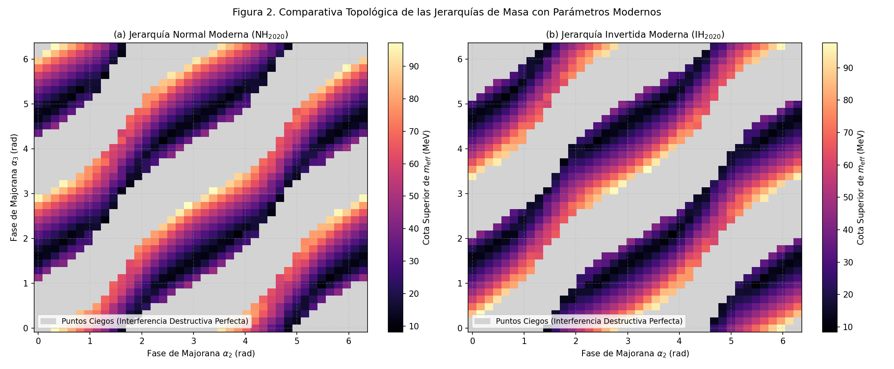

# Neutrinos de Majorana en el sector muónico

**English summary.** Numerical reproduction of the bound on the muonic Majorana effective mass from neutrino–antineutrino conversion ν<sub>μ</sub> → ν̄<sub>μ</sub> (Delepine et al., *Phys. Lett. B* 693, 2010), its update with MINOS+ 2020 and NuFIT 5.2 parameters for both mass orderings, and maps of the bound across the Majorana-phase plane. Python (NumPy, Matplotlib). Undergraduate research project, Mesoamerican Centre for Theoretical Physics, 2025–2026.

Proyecto de investigación desarrollado entre 2025 y 2026 bajo la asesoría del Dr. David G. Delepine (Universidad de Guanajuato, México), en el marco del Diplomado en Física Teórica del Mesoamerican Centre for Theoretical Physics (MCTP).

## Qué calcula

En un experimento de haz como MINOS, un neutrino muónico de Majorana puede convertirse en un antineutrino muónico. La probabilidad de esa conversión depende de la masa efectiva

$$\langle m_{\mu\mu}\rangle = \Big|\sum_i U_{\mu i}^2\, m_i\Big|,$$

de los términos de oscilación entre los tres estados de masa y de las dos fases de Majorana $\alpha_2$ y $\alpha_3$. El límite experimental $P(\nu_\mu\to\bar\nu_\mu) < 0{,}026$ se traduce en una cota superior sobre esa masa.

Los tres programas hacen lo siguiente:

| Programa | Qué hace | Figuras |
|---|---|---|
| `scripts/01_reproduccion_cota_2010.py` | Reproduce la cota de Delepine et al. (2010) con los parámetros de 2009: barrido sobre las fases de Majorana y la masa más ligera, más la aproximación analítica de masas casi degeneradas | `01_espacio_fases_cota_2010.png` |
| `scripts/02_actualizacion_minos_plus.py` | Actualiza la cota con MINOS+ 2020 y NuFIT 5.2 para jerarquía normal (NH) e invertida (IH), con barrido en la fase de Dirac y análisis de sensibilidad a 1 y 2 sigma | `02_mapas_minos_plus_NH_IH.png`, `02_diferencia_NH_IH.png`, `02_contornos_NH_IH.png` |
| `scripts/03_mapas_espacio_de_fases.py` | Compara el plano de fases con los parámetros de 2009 y de 2020, y entre jerarquías, en el régimen de masa pesada | `03_fig1_…`, `03_fig2_…`, `03_fig3_…` |

## Resultado principal

La aproximación analítica reproduce la cota publicada:

| Cantidad | Este código | Delepine et al. (2010) |
|---|---|---|
| Cota sobre $\langle m_{\mu\mu}\rangle$ | 63,25 MeV | ~64 MeV |
| Cota mínima sobre la masa en el plano de fases | 63,27 MeV | |

Con los parámetros de MINOS+ 2020, la cota mediana sobre el plano de fases queda en 38,8 MeV (NH) y 38,2 MeV (IH). Las dos jerarquías dan mapas distintos en forma pero estadísticas casi iguales.



Las zonas grises son "puntos ciegos": combinaciones de fases donde la interferencia entre los términos de oscilación cancela la señal y el límite experimental no restringe la masa.

## Cómo ejecutarlo

```bash
pip install -r requirements.txt
python scripts/01_reproduccion_cota_2010.py
python scripts/02_actualizacion_minos_plus.py
python scripts/03_mapas_espacio_de_fases.py
```

Cada programa tarda menos de un minuto en un portátil y escribe sus figuras en `figuras/`.

## Limitaciones

1. **La escala de masa.** La cota de ~64 MeV está muchos órdenes de magnitud por encima de las masas de neutrino que permiten la cosmología y los experimentos de oscilación (por debajo de 1 eV). El valor de este cálculo es metodológico: reproducir un resultado publicado y entender cómo las fases de Majorana deforman la cota.
2. **La cota conservadora satura el barrido.** El máximo sobre el plano de fases (cerca de 97 MeV) queda pegado al borde superior de la malla de masas (100 MeV), así que refleja el rango del barrido más que una propiedad física.
3. **El máximo de la aproximación analítica.** En los puntos donde el coeficiente geométrico $A$ se acerca a cero, la cota $m \le \sqrt{10^{-3}E^2/A}$ se dispara (hasta unos 84 000 MeV). Son cancelaciones casi completas, no cotas físicas; por eso se reporta el mínimo y la mediana.

## Corrección respecto a la versión original

En la versión original del bloque analítico, el término oscilatorio usaba `sin(2.534 * fase_base)`. Como `fase_base` ya contenía el factor 1,267, la fase quedaba multiplicada dos veces. La forma correcta es `sin(2 * fase_base)`, que es la que ya usaban los programas 02 y 03. Con la corrección, la cota mínima pasa de 68,62 MeV a 63,27 MeV y coincide con la cota analítica.

## Referencias

- D. Delepine, V. González Macías, S. Khalil y G. López Castro, "Probing Majorana neutrino CP phases and masses in neutrino–antineutrino conversion", *Phys. Lett. B* **693**, 438–442 (2010). doi:10.1016/j.physletb.2010.08.068
- P. Adamson et al. (MINOS+), "Precision constraints for three-flavor neutrino oscillations from the full MINOS+ and MINOS dataset", *Phys. Rev. Lett.* **125**, 131802 (2020).
- NuFIT 5.2 (2022), www.nu-fit.org.

## Autoría y uso de IA

El código se desarrolló con asistencia de IA bajo mi dirección. El planteamiento físico, las decisiones del análisis y la verificación de los resultados son míos.

## Autor

César Elías Peña Aparicio, Licenciatura en Física, Universidad de El Salvador.
[LinkedIn](https://www.linkedin.com/in/cesar-pena-fisica) · cesareli200@gmail.com

Licencia MIT. Ver [LICENSE](LICENSE).
